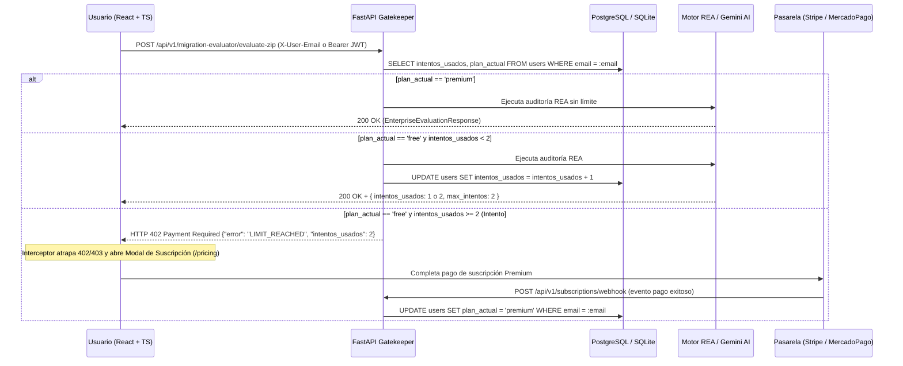

# Skill: Gatekeeper de Suscripción Freemium en Backend (`freemium-subscription-gatekeeper`)

Esta skill guía la implementación en **FastAPI + SQLAlchemy 2.0** del modelo interactivo **Freemium de 2 Intentos Gratuitos** especificado en [`plan_suscripcion.txt`](../../../plan_suscripcion.txt).

---

## 1. Arquitectura de 4 Pilares del Modelo Freemium (`plan_suscripcion.txt`)



---

## 2. Paso 1: Modelo de Base de Datos (`app/models/user.py` y `schema.sql`)

Cada usuario (o registro rápido por correo) en la tabla `users` debe contar con las columnas de control de cuota:

- **`id`** (`UUID` / `String(36)`): Identificador único del usuario.
- **`email`** (`VARCHAR(160) UNIQUE NOT NULL`): Correo ingresado por el usuario (identificador único de la prueba gratuita).
- **`intentos_usados`** (`INTEGER NOT NULL DEFAULT 0`): Contador que inicia en `0` y se incrementa en `+1` tras cada evaluación exitosa en plan `'free'`.
- **`plan_actual`** (`VARCHAR(20) NOT NULL DEFAULT 'free'`): Estado de suscripción (`'free'` o `'premium'`).
- **`stripe_customer_id` / `subscription_updated_at`** (opcionales): Trazabilidad de la pasarela de pagos.

---

## 3. Paso 2: Lógica del Backend — El "Gatekeeper" (`app/services/subscription_gatekeeper.py`)

El núcleo de esta lógica ocurre en un validador/dependencia de FastAPI antes de ejecutar cualquier acción pesada (`/evaluate-zip`, `/evaluate-github`, creación de propuestas REA):

1. **Identificación por Correo o Token**:
   - Extrae el correo desde el encabezado `X-User-Email`, el campo `email` del formulario/body o el claim `email` del token JWT (`Authorization: Bearer ...`).
   - Si el correo no existe aún en `users`, crea un **registro rápido** con `intentos_usados = 0` y `plan_actual = 'free'`.
2. **Validación de Plan (`plan_actual`)**:
   - Si `user.plan_actual == "premium"`, permite la ejecución inmediata sin restricciones ni límite de intentos.
3. **Validación de Intentos (`intentos_usados < 2`)**:
   - Si `user.plan_actual == "free"`:
     - Verifica `if user.intentos_usados >= 2:`.
     - **Si es `>= 2` (Intento #3 en adelante)**: Bloquea la petición **antes** de descomprimir el `.zip` o consumir tokens de Google Gemini y lanza `HTTPException` con código **`402 Payment Required`** (o `403 Forbidden`) y el contrato exacto:
       ```json
       {
         "error": "LIMIT_REACHED",
         "message": "Has agotado tus 2 intentos gratuitos en Cloud Diagnostix. Actualiza al Plan Premium para continuar auditando proyectos ilimitados.",
         "email": "usuario@empresa.com",
         "intentos_usados": 2,
         "max_intentos": 2,
         "plan_actual": "free",
         "upgrade_url": "/pricing"
       }
       ```
     - **Si es `< 2` (Intentos #1 y #2)**: Ejecuta la evaluación del Motor REA, incrementa `user.intentos_usados += 1`, hace `db.commit()` y devuelve `HTTP 200 OK` incluyendo la metadata de cuota restante.

---

## 4. Paso 3: Endpoints de Suscripción y Webhook de Pasarela (`app/api/v1/endpoints/subscriptions.py`)

Expón los siguientes endpoints bajo `/api/v1/subscriptions`:

1. **`POST /api/v1/subscriptions/register-trial`**:
   - Recibe `{"email": "usuario@correo.com"}`.
   - Crea o recupera el usuario en la BD y devuelve su estado actual (`intentos_usados`, `intentos_restantes`, `plan_actual`).
2. **`GET /api/v1/subscriptions/status?email=...`**:
   - Permite al frontend en React consultar cuántos intentos gratuitos le quedan al correo actual.
3. **`POST /api/v1/subscriptions/checkout`**:
   - Crea la sesión de pago (Stripe Checkout / MercadoPago Preference) para pasar de `'free'` a `'premium'`.
4. **`POST /api/v1/subscriptions/webhook`**:
   - Recibe la notificación firmada de la pasarela (ej. `checkout.session.completed` en Stripe o `payment.updated` en MercadoPago) y ejecuta:
     ```sql
     UPDATE users SET plan_actual = 'premium', updated_at = NOW() WHERE email = :email;
     ```
   - Desbloquea instantáneamente la cuenta en la siguiente petición del frontend.

Consulta el código completo de referencia con comentarios obligatorios en [`references/backend_gatekeeper_reference.md`](./references/backend_gatekeeper_reference.md).

