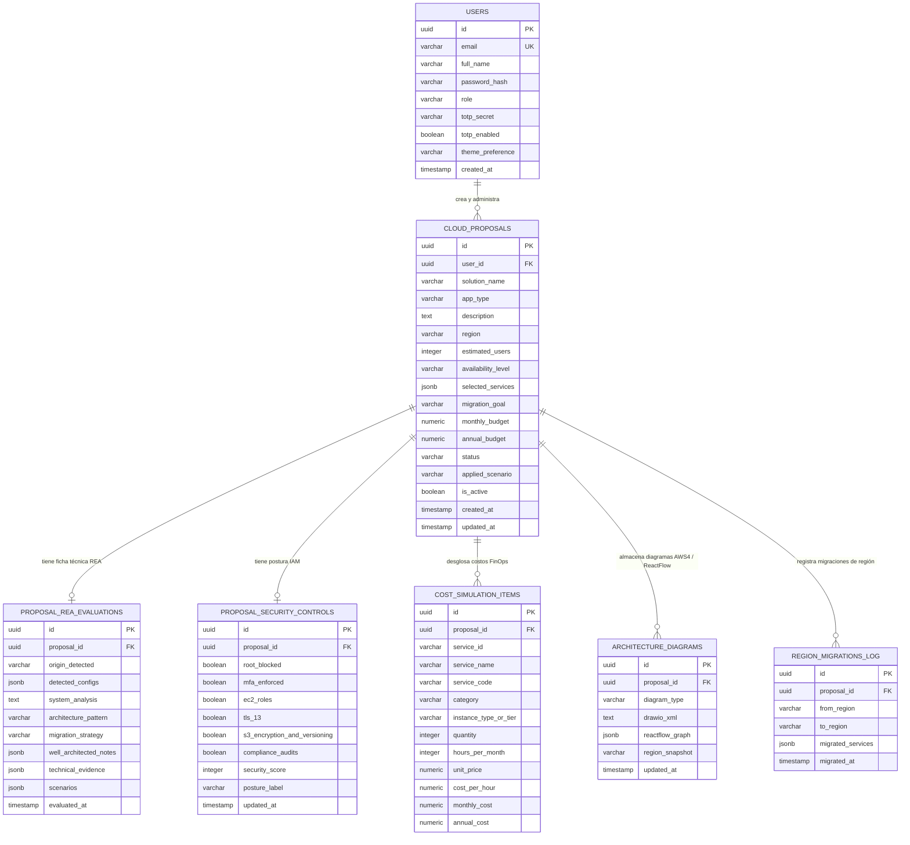

# 01. Modelo de Datos y Esquema de Base de Datos (PostgreSQL)

Este documento define las tablas, relaciones y estructuras JSONB necesarias para persistir todos los módulos de **Cloud Diagnostix**: Usuarios con 2FA (TOTP), Propuestas de Arquitectura AWS, Evaluaciones del Motor REA, Postura de Seguridad IAM por Migración, Simulación de Costos FinOps, Historial de Migraciones entre Regiones y Diagramas (`.drawio` / React Flow).

---

## 1. Diagrama Entidad-Relación (ERD)



---

## 2. Script DDL Completo (PostgreSQL 16)

```sql
CREATE EXTENSION IF NOT EXISTS "pgcrypto";

-- =========================================================
-- 1. TABLA DE USUARIOS Y SEGURIDAD TOTP (MFA)
-- =========================================================
CREATE TABLE users (
    id UUID PRIMARY KEY DEFAULT gen_random_uuid(),
    email VARCHAR(160) UNIQUE NOT NULL,
    full_name VARCHAR(120) NOT NULL,
    password_hash VARCHAR(255) NOT NULL,
    role VARCHAR(60) NOT NULL DEFAULT 'Cloud Architect',
    totp_secret VARCHAR(64) NOT NULL DEFAULT 'JBSWY3DPEHPK3PXP',
    totp_enabled BOOLEAN NOT NULL DEFAULT TRUE,
    theme_preference VARCHAR(16) NOT NULL DEFAULT 'light' CHECK (theme_preference IN ('light', 'dark')),
    created_at TIMESTAMPTZ NOT NULL DEFAULT NOW(),
    updated_at TIMESTAMPTZ NOT NULL DEFAULT NOW()
);

-- =========================================================
-- 2. TABLA DE PROPUESTAS DE ARQUITECTURA CLOUD
-- =========================================================
CREATE TABLE cloud_proposals (
    id UUID PRIMARY KEY DEFAULT gen_random_uuid(),
    user_id UUID REFERENCES users(id) ON DELETE SET NULL,
    solution_name VARCHAR(200) NOT NULL,
    app_type VARCHAR(80) NOT NULL CHECK (
        app_type IN (
            'E-commerce & Retail',
            'API REST / Backend',
            'Microservicios Cloud',
            'Data Lake & Analítica',
            'Portal Web Empresarial'
        )
    ),
    description TEXT NOT NULL,
    region VARCHAR(40) NOT NULL DEFAULT 'sa-east-1',
    estimated_users INTEGER NOT NULL DEFAULT 5000 CHECK (estimated_users > 0),
    availability_level VARCHAR(80) NOT NULL CHECK (
        availability_level IN (
            '99.9% (Básico Multi-AZ)',
            '99.95% (Alta Disponibilidad)',
            '99.99% (Misión Crítica Multi-Región)'
        )
    ),
    selected_services JSONB NOT NULL DEFAULT '["EC2", "RDS", "S3", "VPC", "IAM"]'::jsonb,
    migration_goal VARCHAR(100) NOT NULL CHECK (
        migration_goal IN (
            'Modernización de Aplicación',
            'Reducción de Costos',
            'Escalabilidad Elástica',
            'Continuidad de Negocio y DR'
        )
    ),
    monthly_budget NUMERIC(12, 2) NOT NULL DEFAULT 0.00,
    annual_budget NUMERIC(12, 2) NOT NULL DEFAULT 0.00,
    status VARCHAR(40) NOT NULL DEFAULT 'Aprobada' CHECK (
        status IN ('Aprobada', 'En Revisión', 'Borrador', 'Rechazada', 'Requiere Ajustes')
    ),
    applied_scenario VARCHAR(80) DEFAULT 'Recommended-Production',
    is_active BOOLEAN NOT NULL DEFAULT FALSE,
    created_at TIMESTAMPTZ NOT NULL DEFAULT NOW(),
    updated_at TIMESTAMPTZ NOT NULL DEFAULT NOW()
);

CREATE INDEX idx_proposals_user ON cloud_proposals(user_id);
CREATE INDEX idx_proposals_region ON cloud_proposals(region);

-- =========================================================
-- 3. TABLA DE EVALUACIÓN TÉCNICA REA (FICHA TÉCNICA)
-- =========================================================
CREATE TABLE proposal_rea_evaluations (
    id UUID PRIMARY KEY DEFAULT gen_random_uuid(),
    proposal_id UUID UNIQUE NOT NULL REFERENCES cloud_proposals(id) ON DELETE CASCADE,
    status VARCHAR(20) NOT NULL DEFAULT 'success',
    origin_detected VARCHAR(160) NOT NULL,
    detected_configs JSONB NOT NULL DEFAULT '[]'::jsonb,
    system_analysis TEXT NOT NULL,
    architecture_pattern VARCHAR(180) NOT NULL,
    migration_strategy VARCHAR(120) NOT NULL,
    well_architected_notes JSONB NOT NULL DEFAULT '[]'::jsonb,
    technical_evidence JSONB NOT NULL DEFAULT '{}'::jsonb,
    scenarios JSONB NOT NULL DEFAULT '[]'::jsonb,
    evaluated_at TIMESTAMPTZ NOT NULL DEFAULT NOW()
);

-- =========================================================
-- 4. TABLA DE POSTURA DE SEGURIDAD E IAM POR MIGRACIÓN
-- =========================================================
CREATE TABLE proposal_security_controls (
    id UUID PRIMARY KEY DEFAULT gen_random_uuid(),
    proposal_id UUID UNIQUE NOT NULL REFERENCES cloud_proposals(id) ON DELETE CASCADE,
    root_blocked BOOLEAN NOT NULL DEFAULT TRUE,
    mfa_enforced BOOLEAN NOT NULL DEFAULT TRUE,
    ec2_roles BOOLEAN NOT NULL DEFAULT TRUE,
    tls_13 BOOLEAN NOT NULL DEFAULT TRUE,
    s3_encryption_and_versioning BOOLEAN NOT NULL DEFAULT TRUE,
    compliance_audits BOOLEAN NOT NULL DEFAULT TRUE,
    security_score INTEGER NOT NULL DEFAULT 100 CHECK (security_score BETWEEN 0 AND 100),
    posture_label VARCHAR(40) NOT NULL DEFAULT 'Postura Robusta',
    updated_at TIMESTAMPTZ NOT NULL DEFAULT NOW()
);

-- =========================================================
-- 5. TABLA DE ÍTEMS DE SIMULACIÓN DE COSTOS (FINOPS)
-- =========================================================
CREATE TABLE cost_simulation_items (
    id UUID PRIMARY KEY DEFAULT gen_random_uuid(),
    proposal_id UUID NOT NULL REFERENCES cloud_proposals(id) ON DELETE CASCADE,
    service_id VARCHAR(60) NOT NULL,
    service_name VARCHAR(160) NOT NULL,
    service_code VARCHAR(50) NOT NULL,
    category VARCHAR(80) NOT NULL,
    instance_type_or_tier VARCHAR(160) NOT NULL,
    quantity INTEGER NOT NULL DEFAULT 1 CHECK (quantity > 0),
    hours_per_month INTEGER NOT NULL DEFAULT 730,
    unit VARCHAR(40) DEFAULT 'hour',
    unit_price NUMERIC(12, 4) DEFAULT 0.0000,
    cost_per_hour NUMERIC(12, 4) DEFAULT 0.0000,
    monthly_cost NUMERIC(12, 2) NOT NULL DEFAULT 0.00,
    annual_cost NUMERIC(12, 2) NOT NULL DEFAULT 0.00,
    created_at TIMESTAMPTZ NOT NULL DEFAULT NOW()
);

CREATE INDEX idx_cost_items_proposal ON cost_simulation_items(proposal_id);

-- =========================================================
-- 6. TABLA DE DIAGRAMAS DE ARQUITECTURA (DRAW.IO AWS4 & REACT FLOW)
-- =========================================================
CREATE TABLE architecture_diagrams (
    id UUID PRIMARY KEY DEFAULT gen_random_uuid(),
    proposal_id UUID NOT NULL REFERENCES cloud_proposals(id) ON DELETE CASCADE,
    diagram_type VARCHAR(30) NOT NULL DEFAULT 'drawio_aws4' CHECK (diagram_type IN ('drawio_aws4', 'reactflow')),
    drawio_xml TEXT,
    reactflow_graph JSONB,
    region_snapshot VARCHAR(40) NOT NULL,
    updated_at TIMESTAMPTZ NOT NULL DEFAULT NOW(),
    UNIQUE (proposal_id, diagram_type)
);

-- =========================================================
-- 7. BITÁCORA DE MIGRACIONES ENTRE REGIONES AWS (GLOBO 3D)
-- =========================================================
CREATE TABLE region_migrations_log (
    id UUID PRIMARY KEY DEFAULT gen_random_uuid(),
    proposal_id UUID NOT NULL REFERENCES cloud_proposals(id) ON DELETE CASCADE,
    from_region VARCHAR(40) NOT NULL,
    to_region VARCHAR(40) NOT NULL,
    migrated_services JSONB NOT NULL DEFAULT '[]'::jsonb,
    migrated_at TIMESTAMPTZ NOT NULL DEFAULT NOW()
);
```

---

## 3. Estructura del JSONB `scenarios` en `proposal_rea_evaluations`

La columna `scenarios` almacena los 3 escenarios que devuelve el motor REA (`Cost-Optimized`, `Recommended-Production`, `High-Availability-Enterprise`):

```json
[
  {
    "scenario_type": "Recommended-Production",
    "summary": "Balance óptimo recomendado por REA entre alta disponibilidad Multi-AZ, rendimiento y costo mensual.",
    "services": [
      {
        "service_name": "Amazon Elastic Compute Cloud (EC2)",
        "service_code": "EC2",
        "category": "Cómputo",
        "role": "Capa de Cómputo de Aplicación",
        "specs": "t3.large (2 vCPU, 8 GB RAM) · Auto Scaling Multi-AZ",
        "quantity": 2,
        "estimated_unit_cost_usd": 60.74,
        "total_monthly_usd": 121.48,
        "reason": "Dimensionado por REA para soportar la concurrencia de usuarios estimada con balanceo elástico."
      }
    ],
    "pricing": {
      "monthly_total_usd": 310.95,
      "annual_total_usd": 3731.40,
      "currency": "USD"
    }
  }
]
```

