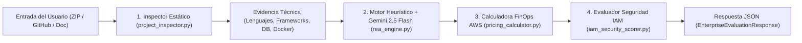

# 03. Motor Evaluador REA (Reasoning & Enterprise Architecture) e IA

El **Motor REA** es el núcleo analítico del backend de **Cloud Diagnostix**. Su función es inspeccionar el código fuente o especificación de un sistema (vía `.zip`, repositorio GitHub o documento), detectar tecnologías y patrones, y generar una arquitectura en AWS alineada con el **AWS Well-Architected Framework**, incluyendo **dimensionamiento de instancias (sizing)**, **3 escenarios de costos** y **controles de seguridad IAM**.

---

## 1. Pipeline de Ejecución del Motor REA



---

## 2. Fase 1: Inspector Estático de Código (`project_inspector.py`)

Cuando el backend recibe un `.zip` o clona un repositorio de GitHub, recorre el árbol de archivos (ignorando `node_modules/`, `.git/`, `venv/`, `dist/`, `__pycache__/`) y extrae señales técnicas clave:

| Archivo / Patrón Detectado | Evidencia Extraída | Servicios AWS Disparados |
| :--- | :--- | :--- |
| `package.json` (`react`, `vite`, `next`, `vue`) | Frontend SPA / SSR | `CloudFront`, `S3`, `Route 53`, `WAF` |
| `package.json` (`express`, `@nestjs/core`, `fastify`) | Backend Node.js | `EC2` o `ECS`, `ALB`, `VPC`, `IAM`, `CloudWatch` |
| `requirements.txt` / `pyproject.toml` (`fastapi`, `django`, `flask`) | Backend Python | `EC2` o `ECS`, `ALB`, `VPC`, `IAM`, `CloudWatch` |
| `Dockerfile` / `docker-compose.yml` | Contenedores Docker | `ECS` (Fargate), `ECR`, `ALB`, `VPC` |
| `pg`, `psycopg2`, `prisma`, `typeorm`, `sqlalchemy` | Base de Datos Relacional | `RDS` (PostgreSQL/MySQL) o `Aurora` |
| `mongoose`, `pymongo`, `dynamodb`, `@aws-sdk/client-dynamodb` | Base de Datos NoSQL | `DynamoDB` |
| `redis`, `ioredis`, `celery`, `bullmq` | Caché en Memoria / Colas | `ElastiCache` (Redis), `SQS`, `SNS` |
| `boto3`, `@aws-sdk/client-s3`, `multer`, `pillow` | Almacenamiento de Objetos | `S3`, `KMS` |
| `jwt`, `pyotp`, `passport`, `bcrypt`, `.env.example` | Secretos e Identidad | `IAM`, `SecretsManager`, `KMS` |

---

## 3. Fase 2: Prompt Estructurado para Google Gemini (`rea_engine.py`)

Si la variable `GEMINI_API_KEY` está configurada, el motor envía el resumen de archivos y dependencias a `gemini-2.5-flash` solicitando salida JSON estricta (`response_mime_type="application/json"`). Si no hay conexión o clave de API, el **Motor Heurístico Determinista** de respaldo genera exactamente la misma estructura sin fallar jamás.

### System Prompt para Gemini 2.5 Flash:

```text
Eres REA (Reasoning & Enterprise Architecture Agent), el motor experto de arquitectura AWS de Cloud Diagnostix.
Analiza la evidencia técnica del proyecto adjunto y diseña una arquitectura en Amazon Web Services para la región {target_region} y el nivel de tráfico {traffic_tier}.

Reglas obligatorias:
1. Usa exclusivamente códigos oficiales de servicios del catálogo:
   ["EC2", "ECS", "Lambda", "RDS", "Aurora", "DynamoDB", "ElastiCache", "S3", "VPC", "Route 53", "CloudFront", "ALB", "WAF", "SQS", "SNS", "IAM", "SecretsManager", "KMS", "CloudWatch"].
2. Devuelve siempre 3 escenarios en el arreglo `scenarios`:
   - "Cost-Optimized": Instancias t3.medium / Serverless básico para pre-producción o MVP.
   - "Recommended-Production": Despliegue Multi-AZ balanceado (t3.large, RDS Multi-AZ, ALB, CloudFront, S3, VPC, IAM).
   - "High-Availability-Enterprise": Arquitectura de misión crítica (m6i.large / ECS Fargate, Aurora Multi-AZ, ElastiCache Redis, WAF, KMS, SecretsManager, CloudWatch).
3. Incluye siempre justificaciones técnicas (`reason`) alineadas con los 6 pilares del AWS Well-Architected Framework.
```

---

## 4. Fase 3: Matriz Oficial de Dimensionamiento y Precios AWS (`pricing_calculator.py`)

El backend calcula los costos mensuales (`730 horas/mes`) usando esta tabla base y aplicando el multiplicador regional correspondiente:

| `service_code` | Nombre Oficial | Rol Arquitectónico REA | Especificación Base (`Recommended-Production`) | Costo Unitario Mensual (USD) |
| :--- | :--- | :--- | :--- | :--- |
| **`Route 53`** | Amazon Route 53 (DNS Cloud) | Resolución DNS Global y Health Checks | Hosted Zone Pública + Health Checks HTTPS | `$0.50` |
| **`CloudFront`** | Amazon CloudFront (CDN) | Red de Entrega de Contenido (CDN) y Caché Edge | Distribución Global Edge (500 GB) + TLS 1.3 | `$42.50` |
| **`WAF`** | AWS WAF (Web Application Firewall) | Protección Perimetral OWASP Top 10 | Web ACL + Reglas Administradas Anti-SQLi/XSS | `$15.00` |
| **`ALB`** | Elastic Load Balancing (ALB) | Balanceo de Carga de Aplicación (Capa 7) | Application Load Balancer Multi-AZ SSL/TLS | `$16.43` |
| **`VPC`** | Amazon Virtual Private Cloud (VPC) | Aislamiento Lógico de Red Cloud | VPC `/16` con Subredes Públicas/Privadas y SG | `$0.00` |
| **`EC2`** | Amazon Elastic Compute Cloud (EC2) | Capa de Cómputo de Aplicación | `t3.large` (2 vCPU, 8 GB RAM) · Auto Scaling Multi-AZ | `$60.74` (x2 = `$121.48`) |
| **`ECS`** | Amazon ECS Fargate | Orquestación Serverless de Contenedores | 2 Tasks Fargate (1 vCPU, 2 GB RAM) Multi-AZ | `$33.58` (x2 = `$67.16`) |
| **`Lambda`** | AWS Lambda | Procesamiento Serverless por Eventos | Funciones 512 MB RAM · 1M invocaciones/mes | `$8.50` |
| **`RDS`** | Amazon RDS (PostgreSQL / MySQL) | Persistencia Transaccional Relacional | `db.t3.large` Multi-AZ con failover automático | `$127.75` |
| **`Aurora`** | Amazon Aurora Serverless v2 | Base de Datos Relacional de Alta Disponibilidad | Cluster Aurora PostgreSQL Multi-AZ (2-8 ACU) | `$175.20` |
| **`DynamoDB`** | Amazon DynamoDB | Almacenamiento NoSQL Clave-Valor | On-Demand + Backups Point-in-Time (PITR) | `$25.00` |
| **`ElastiCache`** | Amazon ElastiCache (Redis) | Caché en Memoria Sub-Milisegundo | `cache.t4g.medium` Redis Multi-AZ | `$37.96` |
| **`S3`** | Amazon Simple Storage Service (S3) | Almacenamiento de Objetos y Activos Estáticos | S3 Standard (100 GB) + Versionado y SSE-KMS | `$2.30` |
| **`SQS`** | Amazon Simple Queue Service (SQS) | Cola de Mensajería Asíncrona | Cola FIFO/Standard Desacoplada | `$4.00` |
| **`SNS`** | Amazon Simple Notification Service | Notificaciones Pub/Sub y Eventos | Tópicos Pub/Sub de Eventos Transaccionales | `$3.50` |
| **`IAM`** | AWS Identity and Access Management | Gobierno de Identidad y Mínimo Privilegio | Roles IAM STS, Políticas RBAC y MFA obligatorio | `$0.00` |
| **`SecretsManager`** | AWS Secrets Manager | Custodia y Rotación de Credenciales | Rotación automática de secretos de BD y API | `$4.00` |
| **`KMS`** | AWS Key Management Service (KMS) | Gestión de Llaves Criptográficas CMK | Claves Maestras CMK con rotación anual | `$3.00` |
| **`CloudWatch`** | Amazon CloudWatch | Observabilidad, Métricas y Alertas | Dashboards de telemetría, Logs y Alarmas CPU | `$12.00` |

### Multiplicadores por Nivel de Tráfico (`traffic_tier`):
- `low` (`<25k req/mes`): Factor `0.68x` (`1x` instancia de cómputo).
- `medium` (`100k - 500k req/mes`): Factor `1.00x` (`2x` instancias Multi-AZ).
- `high` (`>1M req/mes`): Factor `1.45x` (`3x` instancias + caché Redis).
- `enterprise` (`Misión Crítica`): Factor `1.85x` (`4x` instancias + Aurora + WAF + KMS).

