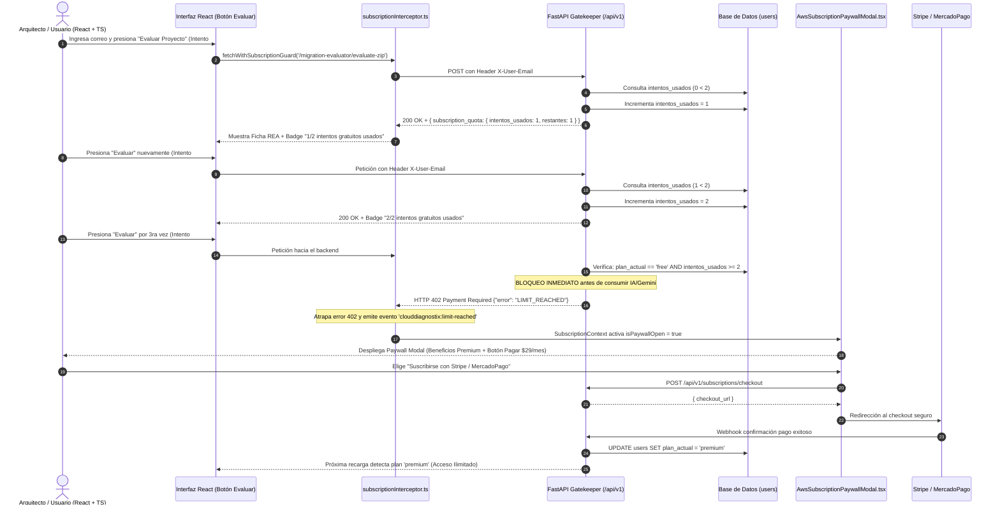

# Plan de Suscripción Freemium (2 Intentos Gratis + Paywall Premium) — `plan_suscripcion.md`

Este documento es la **guía maestra autocontenida** diseñada para el equipo de frontend en **React 19 + TypeScript**. Detalla la lógica de negocio, arquitectura de componentes, contratos de API, interceptor de red, estados globales y diseño visual para implementar la **Prueba Interactiva Freemium (2 intentos gratuitos por correo) y Conversión a Suscripción Premium**.

---

## 1. Visión General y Flujo de Negocio (`plan_suscripcion.txt`)



---

## 2. Endpoints del Módulo de Suscripción (`/api/v1/subscriptions`)

Todos los endpoints están disponibles en el servidor backend: `http://localhost:8080/api/v1` (o `http://localhost:8000/api/v1`).

### 2.1. Registro Rápido de Correo
- **Método**: `POST`
- **Ruta**: `/api/v1/subscriptions/register-trial`
- **Body**:
```json
{
  "email": "usuario@empresa.com",
  "full_name": "Jorge Mendoza"
}
```
- **Respuesta `200 OK`**:
```json
{
  "user_id": "d960fe7a-baf5-4f4c-8f05-e64194cba590",
  "email": "usuario@empresa.com",
  "intentos_usados": 0,
  "max_intentos": 2,
  "intentos_restantes": 2,
  "plan_actual": "free",
  "can_execute": true
}
```

### 2.2. Consulta de Estado de Cuota
- **Método**: `GET`
- **Ruta**: `/api/v1/subscriptions/status?email=usuario@empresa.com` (o enviando el header `X-User-Email: usuario@empresa.com`)
- **Respuesta `200 OK`**: Devuelve el mismo esquema con `intentos_usados`, `intentos_restantes` y `plan_actual` (`"free"` o `"premium"`).

### 2.3. Consumo de Intento (Validador Gatekeeper)
- **Método**: `POST`
- **Ruta**: `/api/v1/subscriptions/consume-attempt`
- **Body**: `{"email": "usuario@empresa.com"}`
- **Respuesta Exitosa (`200 OK`)**: Si `intentos_usados < 2`, suma `+1` y devuelve los datos actualizados.
- **Respuesta Bloqueada (`402 Payment Required`)**: Si `intentos_usados >= 2` en plan `"free"`, bloquea con:
```json
{
  "error": "LIMIT_REACHED",
  "message": "Has alcanzado el límite de 2 intentos gratuitos asociados a tu correo. Actualiza al Plan Premium para desbloquear auditorías REA ilimitadas.",
  "email": "usuario@empresa.com",
  "intentos_usados": 2,
  "max_intentos": 2,
  "plan_actual": "free",
  "upgrade_url": "/pricing"
}
```

### 2.4. Iniciar Checkout de Pago
- **Método**: `POST`
- **Ruta**: `/api/v1/subscriptions/checkout`
- **Body**:
```json
{
  "email": "usuario@empresa.com",
  "provider": "stripe",
  "success_url": "http://localhost:5173/aws-cloud/planning?upgraded=true",
  "cancel_url": "http://localhost:5173/pricing?canceled=true"
}
```
- **Respuesta `200 OK`**:
```json
{
  "checkout_url": "https://checkout.stripe.com/c/pay/cs_test_...",
  "session_id": "chk_stripe_1a2b3c4d",
  "provider": "stripe",
  "email": "usuario@empresa.com",
  "plan_target": "premium",
  "amount_usd": 29.0,
  "currency": "USD"
}
```

### 2.5. Webhook de Pasarela de Pago
- **Método**: `POST`
- **Ruta**: `/api/v1/subscriptions/webhook`
- **Body**:
```json
{
  "event_type": "checkout.session.completed",
  "email": "usuario@empresa.com",
  "provider": "stripe"
}
```
- **Respuesta `200 OK`**:
```json
{
  "received": true,
  "upgraded": true,
  "email": "usuario@empresa.com",
  "plan_actual": "premium",
  "intentos_usados": 2,
  "message": "Suscripción actualizada exitosamente a 'premium'."
}
```

### 2.6. Reset de Prueba (Para Testing / Demos)
- **Método**: `POST`
- **Ruta**: `/api/v1/subscriptions/reset-trial`
- **Body**: `{"email": "usuario@empresa.com"}`
- **Respuesta `200 OK`**: Reinicia el contador a `intentos_usados: 0` y `plan_actual: "free"`.

---

## 3. Estructura de Archivos a Integrar en el Frontend

Copia los archivos ubicados en `plan_suscricion/src/` dentro de tu proyecto React en `src/features/modules/aws-cloud/`:

```text
src/features/modules/aws-cloud/
├── types/
│   └── subscription.types.ts                # Contratos TypeScript de cuota y errores
├── services/
│   └── subscriptionInterceptor.ts           # Wrapper de fetch con intercepción HTTP 402 LIMIT_REACHED
├── context/
│   └── SubscriptionContext.tsx              # Estado global, sincronización y control del Modal
└── components/
    ├── AwsTrialCounterBadge.tsx             # Badge visual de intentos restantes
    ├── AwsSubscriptionPaywallModal.tsx      # Modal de Paywall con planes Stripe / MercadoPago
    └── AwsEmailTrialGateModal.tsx           # Modal inicial para capturar el correo
```

---

## 4. Código Fuente Completo para Copiar y Pegar

### 4.1. Tipos TypeScript (`types/subscription.types.ts`)

```typescript
/**
 * Tipos oficiales para el sistema Freemium de Cloud Diagnostix.
 */
export type SubscriptionPlanType = 'free' | 'premium';

export interface SubscriptionQuotaStatus {
  user_id?: string;
  email: string;
  intentos_usados: number;
  max_intentos: number | null;
  intentos_restantes: number | null;
  plan_actual: SubscriptionPlanType;
  can_execute?: boolean;
}

export interface LimitReachedErrorDetail {
  error: 'LIMIT_REACHED';
  message: string;
  email: string;
  intentos_usados: number;
  max_intentos: number;
  plan_actual: SubscriptionPlanType;
  upgrade_url: string;
}

export interface CheckoutSessionResponse {
  checkout_url: string;
  session_id: string;
  provider: 'stripe' | 'mercadopago';
  email: string;
  plan_target: string;
  amount_usd: number;
  currency: string;
}
```

---

### 4.2. Interceptor de Red HTTP 402/403 (`services/subscriptionInterceptor.ts`)

```typescript
/**
 * Interceptor de red que inyecta el correo del usuario y captura el error
 * HTTP 402 LIMIT_REACHED emitido en el 3er intento por el Gatekeeper.
 */
import { LimitReachedErrorDetail } from '../types/subscription.types';

export const LIMIT_REACHED_EVENT = 'clouddiagnostix:limit-reached';
export const QUOTA_UPDATED_EVENT = 'clouddiagnostix:quota-updated';
const STORAGE_EMAIL_KEY = 'clouddiagnostix_trial_email';

export function getStoredTrialEmail(): string {
  return localStorage.getItem(STORAGE_EMAIL_KEY) || '';
}

export function setStoredTrialEmail(email: string): void {
  localStorage.setItem(STORAGE_EMAIL_KEY, email.trim().toLowerCase());
}

export async function fetchWithSubscriptionGuard(
  input: RequestInfo | URL,
  init?: RequestInit
): Promise<Response> {
  const email = getStoredTrialEmail();
  const headers = new Headers(init?.headers || {});

  // Inyectar X-User-Email para que el backend reconozca la cuota del usuario
  if (email && !headers.has('X-User-Email')) {
    headers.set('X-User-Email', email);
  }

  const response = await fetch(input, {
    ...init,
    headers,
  });

  // Interceptar bloqueo del 3er intento (HTTP 402 Payment Required o 403 Forbidden)
  if (response.status === 402 || response.status === 403) {
    try {
      const cloned = response.clone();
      const body = await cloned.json();
      const detail: LimitReachedErrorDetail | undefined =
        body?.error === 'LIMIT_REACHED'
          ? body
          : body?.detail?.error === 'LIMIT_REACHED'
          ? body.detail
          : undefined;

      if (detail) {
        // Disparar evento para que SubscriptionContext abra el modal de Paywall
        window.dispatchEvent(
          new CustomEvent<LimitReachedErrorDetail>(LIMIT_REACHED_EVENT, { detail })
        );
      }
    } catch {
      // Ignorar errores de parseo
    }
  } else if (response.ok) {
    // Si la acción fue exitosa, notificar para actualizar el contador visual
    window.dispatchEvent(new CustomEvent(QUOTA_UPDATED_EVENT));
  }

  return response;
}
```

---

### 4.3. Contexto Global de Suscripción (`context/SubscriptionContext.tsx`)

```tsx
/**
 * Proveedor de estado global para cuota de prueba, correo y Paywall Modal.
 */
import React, { createContext, useCallback, useContext, useEffect, useState } from 'react';
import {
  LIMIT_REACHED_EVENT,
  QUOTA_UPDATED_EVENT,
  getStoredTrialEmail,
  setStoredTrialEmail,
} from '../services/subscriptionInterceptor';
import {
  LimitReachedErrorDetail,
  SubscriptionPlanType,
  SubscriptionQuotaStatus,
} from '../types/subscription.types';

interface SubscriptionContextValue {
  email: string;
  intentosUsados: number;
  maxIntentos: number;
  intentosRestantes: number;
  planActual: SubscriptionPlanType;
  isPaywallOpen: boolean;
  paywallMessage: string;
  registerTrialEmail: (newEmail: string) => Promise<void>;
  refreshSubscriptionStatus: (overrideEmail?: string) => Promise<void>;
  startPremiumCheckout: (provider?: 'stripe' | 'mercadopago') => Promise<void>;
  resetTrial: () => Promise<void>;
  closePaywallModal: () => void;
  openPaywallModal: () => void;
}

const SubscriptionContext = createContext<SubscriptionContextValue | undefined>(undefined);
const API_BASE_URL = 'http://localhost:8080/api/v1';

export const SubscriptionProvider: React.FC<{ children: React.ReactNode }> = ({ children }) => {
  const [email, setEmail] = useState<string>(() => getStoredTrialEmail());
  const [intentosUsados, setIntentosUsados] = useState<number>(0);
  const [maxIntentos, setMaxIntentos] = useState<number>(2);
  const [planActual, setPlanActual] = useState<SubscriptionPlanType>('free');
  const [isPaywallOpen, setIsPaywallOpen] = useState<boolean>(false);
  const [paywallMessage, setPaywallMessage] = useState<string>(
    'Has utilizado tus 2 intentos gratuitos. Actualiza al Plan Premium para auditorías REA ilimitadas.'
  );

  const refreshSubscriptionStatus = useCallback(async (overrideEmail?: string) => {
    const activeEmail = (overrideEmail ?? email).trim().toLowerCase();
    if (!activeEmail) return;

    try {
      const resp = await fetch(
        `${API_BASE_URL}/subscriptions/status?email=${encodeURIComponent(activeEmail)}`
      );
      if (resp.ok) {
        const data: SubscriptionQuotaStatus = await resp.json();
        setIntentosUsados(data.intentos_usados);
        setMaxIntentos(data.max_intentos ?? 2);
        setPlanActual(data.plan_actual);
      }
    } catch {
      // Modo offline seguro
    }
  }, [email]);

  const registerTrialEmail = useCallback(async (newEmail: string) => {
    const clean = newEmail.trim().toLowerCase();
    setStoredTrialEmail(clean);
    setEmail(clean);

    try {
      const resp = await fetch(`${API_BASE_URL}/subscriptions/register-trial`, {
        method: 'POST',
        headers: { 'Content-Type': 'application/json' },
        body: JSON.stringify({ email: clean }),
      });
      if (resp.ok) {
        const data: SubscriptionQuotaStatus = await resp.json();
        setIntentosUsados(data.intentos_usados);
        setMaxIntentos(data.max_intentos ?? 2);
        setPlanActual(data.plan_actual);
      }
    } catch {
      // Ignorar fallo de red
    }
  }, []);

  useEffect(() => {
    if (email) {
      refreshSubscriptionStatus(email);
    }
  }, [email, refreshSubscriptionStatus]);

  useEffect(() => {
    const handleLimitReached = (event: Event) => {
      const customEvent = event as CustomEvent<LimitReachedErrorDetail>;
      if (customEvent.detail) {
        setIntentosUsados(customEvent.detail.intentos_usados ?? 2);
        setMaxIntentos(customEvent.detail.max_intentos ?? 2);
        setPlanActual('free');
        if (customEvent.detail.message) {
          setPaywallMessage(customEvent.detail.message);
        }
      }
      setIsPaywallOpen(true);
    };

    const handleQuotaUpdated = () => {
      refreshSubscriptionStatus();
    };

    window.addEventListener(LIMIT_REACHED_EVENT, handleLimitReached);
    window.addEventListener(QUOTA_UPDATED_EVENT, handleQuotaUpdated);
    return () => {
      window.removeEventListener(LIMIT_REACHED_EVENT, handleLimitReached);
      window.removeEventListener(QUOTA_UPDATED_EVENT, handleQuotaUpdated);
    };
  }, [refreshSubscriptionStatus]);

  const startPremiumCheckout = useCallback(
    async (provider: 'stripe' | 'mercadopago' = 'stripe') => {
      if (!email) return;
      try {
        const resp = await fetch(`${API_BASE_URL}/subscriptions/checkout`, {
          method: 'POST',
          headers: { 'Content-Type': 'application/json' },
          body: JSON.stringify({ email, provider }),
        });
        if (resp.ok) {
          const data = await resp.json();
          if (data.checkout_url && data.checkout_url.startsWith('http')) {
            window.location.href = data.checkout_url;
            return;
          }
        }
        // Simulación en entorno de desarrollo local
        await fetch(`${API_BASE_URL}/subscriptions/webhook`, {
          method: 'POST',
          headers: { 'Content-Type': 'application/json' },
          body: JSON.stringify({
            event_type: 'checkout.session.completed',
            email,
            provider,
          }),
        });
        await refreshSubscriptionStatus(email);
        setIsPaywallOpen(false);
      } catch {
        // Manejar fallo de checkout
      }
    },
    [email, refreshSubscriptionStatus]
  );

  const resetTrial = useCallback(async () => {
    if (!email) return;
    await fetch(`${API_BASE_URL}/subscriptions/reset-trial`, {
      method: 'POST',
      headers: { 'Content-Type': 'application/json' },
      body: JSON.stringify({ email }),
    });
    await refreshSubscriptionStatus(email);
  }, [email, refreshSubscriptionStatus]);

  const intentosRestantes = Math.max(maxIntentos - intentosUsados, 0);

  return (
    <SubscriptionContext.Provider
      value={{
        email,
        intentosUsados,
        maxIntentos,
        intentosRestantes,
        planActual,
        isPaywallOpen,
        paywallMessage,
        registerTrialEmail,
        refreshSubscriptionStatus,
        startPremiumCheckout,
        resetTrial,
        closePaywallModal: () => setIsPaywallOpen(false),
        openPaywallModal: () => setIsPaywallOpen(true),
      }}
    >
      {children}
    </SubscriptionContext.Provider>
  );
};

export function useSubscription(): SubscriptionContextValue {
  const ctx = useContext(SubscriptionContext);
  if (!ctx) {
    throw new Error('useSubscription debe usarse dentro de un <SubscriptionProvider>');
  }
  return ctx;
}
```

---

### 4.4. Badge Contador de Intentos (`components/AwsTrialCounterBadge.tsx`)

Colócalo en el header o barra superior de tu pantalla de Planificación Cloud:

```tsx
/**
 * Badge visual que muestra el estado de suscripción y los intentos gratuitos.
 */
import React from 'react';
import { useSubscription } from '../context/SubscriptionContext';

export const AwsTrialCounterBadge: React.FC = () => {
  const { planActual, intentosUsados, maxIntentos, openPaywallModal } = useSubscription();

  if (planActual === 'premium') {
    return (
      <span className="inline-flex items-center gap-1.5 rounded-full bg-emerald-500/15 px-3 py-1 text-xs font-semibold text-emerald-400 border border-emerald-500/30">
        <span className="h-1.5 w-1.5 rounded-full bg-emerald-400 animate-pulse" />
        PLAN PREMIUM ILIMITADO
      </span>
    );
  }

  const isLimitReached = intentosUsados >= maxIntentos;

  return (
    <div className="flex items-center gap-2">
      <span
        className={`inline-flex items-center gap-1.5 rounded-full px-3 py-1 text-xs font-medium border ${
          isLimitReached
            ? 'bg-rose-500/15 text-rose-400 border-rose-500/30'
            : 'bg-amber-500/15 text-amber-300 border-amber-500/30'
        }`}
      >
        <span
          className={`h-1.5 w-1.5 rounded-full ${
            isLimitReached ? 'bg-rose-400' : 'bg-amber-400'
          }`}
        />
        Prueba Gratis: {intentosUsados}/{maxIntentos} usados
      </span>

      <button
        onClick={openPaywallModal}
        className="rounded-lg bg-gradient-to-r from-amber-500 to-orange-500 px-2.5 py-1 text-xs font-bold text-slate-950 hover:brightness-110 shadow-sm"
      >
        Actualizar a Premium
      </button>
    </div>
  );
};
```

---

### 4.5. Modal Paywall de Suscripción (`components/AwsSubscriptionPaywallModal.tsx`)

Este modal se abre **automáticamente** cuando el usuario realiza el 3er intento y el interceptor captura `HTTP 402 LIMIT_REACHED`:

```tsx
/**
 * Modal Paywall moderno con diseño Tailwind CSS para conversión a Premium.
 */
import React, { useState } from 'react';
import { useSubscription } from '../context/SubscriptionContext';

export const AwsSubscriptionPaywallModal: React.FC = () => {
  const {
    email,
    intentosUsados,
    maxIntentos,
    planActual,
    isPaywallOpen,
    paywallMessage,
    startPremiumCheckout,
    closePaywallModal,
  } = useSubscription();

  const [loadingProvider, setLoadingProvider] = useState<'stripe' | 'mercadopago' | null>(null);

  if (!isPaywallOpen || planActual === 'premium') {
    return null;
  }

  const handleCheckout = async (provider: 'stripe' | 'mercadopago') => {
    setLoadingProvider(provider);
    try {
      await startPremiumCheckout(provider);
    } finally {
      setLoadingProvider(null);
    }
  };

  return (
    <div className="fixed inset-0 z-50 flex items-center justify-center bg-slate-950/80 backdrop-blur-md p-4 animate-in fade-in duration-200">
      <div className="relative w-full max-w-lg overflow-hidden rounded-3xl border border-amber-500/40 bg-gradient-to-b from-slate-900 to-slate-950 p-7 text-white shadow-2xl">
        {/* Glow de fondo */}
        <div className="absolute -top-24 -right-24 h-48 w-48 rounded-full bg-amber-500/20 blur-3xl pointer-events-none" />

        {/* Encabezado */}
        <div className="flex items-center justify-between pb-3">
          <span className="inline-flex items-center gap-1.5 rounded-full bg-amber-500/20 px-3 py-1 text-xs font-bold text-amber-400 border border-amber-500/30">
            ⚠️ LÍMITE DE PRUEBA ALCANZADO ({intentosUsados}/{maxIntentos})
          </span>
          <button
            onClick={closePaywallModal}
            className="rounded-full p-1 text-slate-400 hover:bg-slate-800 hover:text-white transition-colors"
          >
            ✕
          </button>
        </div>

        <h3 className="mt-3 text-2xl font-extrabold tracking-tight text-white">
          Desbloquea Auditorías Ilimitadas
        </h3>
        <p className="mt-2 text-sm text-slate-300 leading-relaxed">{paywallMessage}</p>

        {email && (
          <div className="mt-3 rounded-xl bg-slate-800/60 border border-slate-700/60 px-3.5 py-2 text-xs text-slate-300 flex items-center justify-between">
            <span>Correo vinculado:</span>
            <span className="font-mono font-semibold text-amber-300">{email}</span>
          </div>
        )}

        {/* Comparativa de Beneficios */}
        <div className="mt-5 rounded-2xl bg-slate-900/90 border border-slate-800 p-4 space-y-2.5 text-xs">
          <div className="flex items-center gap-2 text-slate-200">
            <span className="text-emerald-400 font-bold">✓</span>
            <span>Auditorías REA de código (.zip y GitHub) <strong>sin límite</strong></span>
          </div>
          <div className="flex items-center gap-2 text-slate-200">
            <span className="text-emerald-400 font-bold">✓</span>
            <span>Motor de IA Google Gemini 2.5 Flash + 3 Escenarios FinOps</span>
          </div>
          <div className="flex items-center gap-2 text-slate-200">
            <span className="text-emerald-400 font-bold">✓</span>
            <span>Generación y descarga ilimitada de diagramas Draw.io oficiales (mxgraph.aws4)</span>
          </div>
          <div className="flex items-center gap-2 text-slate-200">
            <span className="text-emerald-400 font-bold">✓</span>
            <span>Exportación de Ficha Técnica REA en PDF A4 y Calificación IAM (0-100 pts)</span>
          </div>
        </div>

        {/* Precio y Botones de Pago */}
        <div className="mt-6 flex items-baseline justify-between border-t border-slate-800/80 pt-4">
          <div>
            <span className="text-xs uppercase tracking-wider text-slate-400">Plan Cloud Architect</span>
            <div className="flex items-baseline gap-1">
              <span className="text-3xl font-black text-white">$29</span>
              <span className="text-xs text-slate-400">USD / mes</span>
            </div>
          </div>
          <span className="text-xs text-emerald-400 font-medium">Cancela en cualquier momento</span>
        </div>

        <div className="mt-4 flex flex-col gap-2.5 sm:flex-row">
          <button
            disabled={loadingProvider !== null}
            onClick={() => handleCheckout('stripe')}
            className="flex-1 rounded-xl bg-gradient-to-r from-amber-500 to-amber-600 px-4 py-3 text-sm font-bold text-slate-950 hover:brightness-110 active:scale-[0.98] transition-all disabled:opacity-50 shadow-lg shadow-amber-500/20"
          >
            {loadingProvider === 'stripe' ? 'Conectando...' : 'Pagar con Tarjeta (Stripe)'}
          </button>
          <button
            disabled={loadingProvider !== null}
            onClick={() => handleCheckout('mercadopago')}
            className="flex-1 rounded-xl border border-sky-500/40 bg-sky-500/10 px-4 py-3 text-sm font-semibold text-sky-200 hover:bg-sky-500/20 active:scale-[0.98] transition-all disabled:opacity-50"
          >
            {loadingProvider === 'mercadopago' ? 'Conectando...' : 'MercadoPago'}
          </button>
        </div>
      </div>
    </div>
  );
};
```

---

## 5. Instrucciones de Integración en tu Aplicación React

Envuelve tu vista o layout principal en `App.tsx` (o en tu página `AwsPlanning.tsx`) con el `<SubscriptionProvider>`:

```tsx
import React from 'react';
import { SubscriptionProvider } from './features/modules/aws-cloud/context/SubscriptionContext';
import { AwsSubscriptionPaywallModal } from './features/modules/aws-cloud/components/AwsSubscriptionPaywallModal';
import { AwsTrialCounterBadge } from './features/modules/aws-cloud/components/AwsTrialCounterBadge';
import { AwsPlanning } from './features/modules/aws-cloud/pages/AwsPlanning';

export function AwsCloudModule() {
  return (
    <SubscriptionProvider>
      <header className="flex justify-between items-center p-4 bg-slate-900 border-b border-slate-800">
        <h1 className="text-lg font-bold text-white">Cloud Diagnostix AWS</h1>
        {/* Muestra: "Prueba Gratis: 1/2 usados" o "PLAN PREMIUM ILIMITADO" */}
        <AwsTrialCounterBadge />
      </header>

      <main>
        <AwsPlanning />
      </main>

      {/* Paywall Modal: se abre automáticamente ante el error 402 LIMIT_REACHED en el 3er intento */}
      <AwsSubscriptionPaywallModal />
    </SubscriptionProvider>
  );
}
```

---

## 6. Checklist de Validación del Flujo Freemium

1. **Intento #1**: Sube un archivo `.zip` o pon un repositorio de GitHub $\rightarrow$ El backend devuelve `HTTP 200 OK` y el badge se actualiza a `1/2 usados`.
2. **Intento #2**: Realiza otra evaluación $\rightarrow$ El backend devuelve `HTTP 200 OK` y el badge pasa a `2/2 usados`.
3. **Intento #3**: Presiona el botón de evaluación por tercera vez $\rightarrow$ El backend bloquea con `HTTP 402 Payment Required` (`{"error": "LIMIT_REACHED"}`), el interceptor lo captura y se despliega automáticamente el `<AwsSubscriptionPaywallModal />`.
4. **Pago / Conversión**: Selecciona Stripe o MercadoPago $\rightarrow$ Se procesa el webhook y el badge cambia a `PLAN PREMIUM ILIMITADO`, permitiendo auditorías continuas sin bloqueos.

